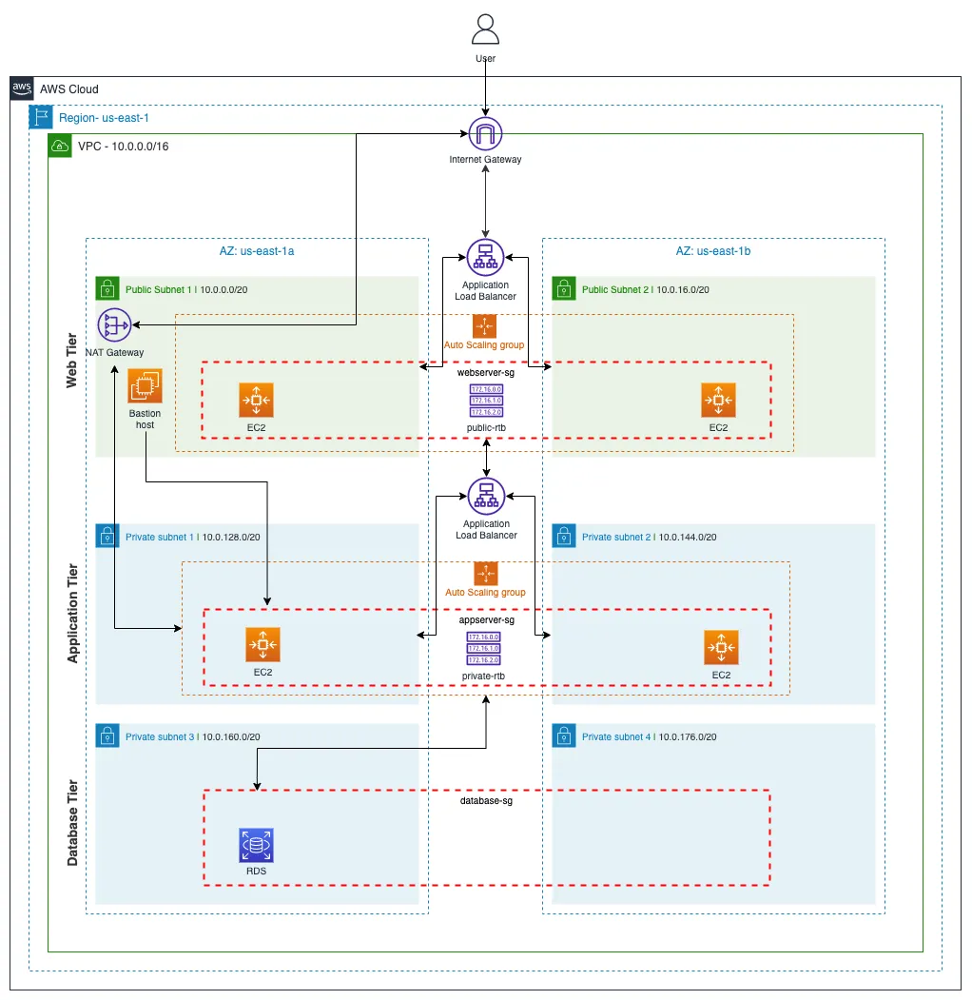

# Three-Tier AWS Architecture with Terraform

A three-tier web architecture on AWS, deployed through Terraform. 
I used 3 tiers (public web tier, private application tier, and a private database tier) spread across two Availability Zones with security groups that limit access from tier to tier.




## Why I built this
I'm moving from IT Support to cloud and security work. This project is based on Aalok Trivedi's article [Building a 3-tier web application architecture with AWS](https://medium.com/@aaloktrivedi/building-a-3-tier-web-application-architecture-with-aws-eb5981613e30), which builds a similar architecture through the AWS console. I rebuilt it using Terraform and implemented some changes for improved security. 

## What was changed
- **Terraform:** I built the entire project in Terraform, so it's repeatable, reviewable and version-controlled.
- **No bastion host:** I replaced it with Systems Manager Session Manager. This removed the bastion's public IP, open SSH port and SSH key pairs, moved access control to IAM, and lowered cost, since Session Manager is free and a bastion is an EC2 instance.
- **IMDSv2 required:** I set IMDSv2 to be required on all instances, which stops SSRF-based credential theft and satisfies the IMDSv2 checks in CIS and Security Hub.
- **Security groups chained tier to tier:** each tier only accepts traffic from the tier in front of it.
- **RDS password in Secrets Manager:** I have RDS generate the database password and store it in Secrets Manager. It never appears in my code or in the Terraform state.


## What it builds

| Layer | Resources |
|---|---|
| Network | 1 VPC (`10.0.0.0/16`), 6 subnets across `us-east-1a` and `us-east-1b`, internet gateway, NAT gateway, public and private route tables |
| Web tier | Internet-facing Application Load Balancer, Auto Scaling group (2 to 4 `t3.micro`) in public subnets, running nginx |
| App tier | Internal Application Load Balancer, Auto Scaling group (2 to 4 `t3.micro`) in private subnets, running nginx |
| Database tier | RDS PostgreSQL (`db.t3.micro`) in private DB subnets, encrypted, not publicly accessible, password managed by Secrets Manager |
| Access and IAM | EC2 instance profile with `AmazonSSMManagedInstanceCore`, so instances are managed through Session Manager (no SSH, no bastion host) |

About 50 resources in total.

## Traffic flow

```
User
  │  HTTP :80
  ▼
Internet Gateway
  ▼
Web ALB (public subnets, web-alb-sg)
  ▼
Web ASG instances (public subnets, web-ec2-sg)
  │  HTTP :80
  ▼
App ALB (internal, private app subnets, app-alb-sg)
  ▼
App ASG instances (private app subnets, app-ec2-sg)
  │  PostgreSQL :5432
  ▼
RDS (private DB subnets, db-sg)
```

Private instances reach the internet (package installs, SSM) outbound only, through the NAT gateway.

## Security design

Each security group allows inbound traffic only from the tier directly above it, referencing security groups rather than CIDR ranges.

| Security group | Allows inbound from | Port |
|---|---|---|
| `web_alb_sg` | Internet (`0.0.0.0/0`) | 80 |
| `web_ec2_sg` | `web_alb_sg` | 80 |
| `app_alb_sg` | `web_ec2_sg` | 80 |
| `app_ec2_sg` | `app_alb_sg` | 80 |
| `db_sg` | `app_ec2_sg` | 5432 |

Other controls:

- **No SSH and no bastion host.** Access is through AWS Systems Manager Session Manager using an IAM instance profile, so there are no inbound admin ports and no key pairs to manage.
- **IMDSv2 required** on all launch templates (`http_tokens = "required"`), which blocks the SSRF-to-credentials attack path that IMDSv1 allows.
- **RDS** has `storage_encrypted = true`, `publicly_accessible = false`, and `manage_master_user_password = true`, so the password lives in Secrets Manager and never appears in code.
- **Private subnets** do not assign public IPs, and the internal ALB has no public address.
- **ELB health checks** drive the Auto Scaling groups, so unhealthy instances are replaced automatically.
- **Acyclic security group design:** Decoupled inline rules into discrete resources to eliminate dependency cycles while enforcing strict SG-to-SG chaining.
- **Isolated database routing:** Database subnets are associated with a dedicated route table containing no NAT or IGW routes, preventing direct egress to the internet entirely. 


## Troubleshooting: Resolving Terraform Dependency Cycles

Terraform builds a Directed Acyclic Graph (DAG) to map resource dependencies and determine provisioning order. During initial deployment, defining security groups with inline `ingress` and `egress` blocks triggered an `Error: Cycle` deadlock. Because the Web and App tiers mutually referenced each other, Terraform could not create either security group without the other's ID already existing.

**Resolution:**
Decoupled inline firewall rules into discrete `aws_vpc_security_group_ingress_rule` and `aws_vpc_security_group_egress_rule` resources. This refactor eliminated the cycle by enabling two-phase provisioning:

1. **Phase 1:** Terraform creates the base security group shells in parallel and records their resource IDs (`sg-xxxx`).
2. **Phase 2:** Terraform attaches the individual ingress and egress rules downstream once all IDs exist, restoring a valid Directed Acyclic Graph while preserving least-privilege tier isolation.


## Repository layout

```
├── provider.tf    # Terraform and AWS provider configuration
├── network.tf     # VPC, subnets, IGW, NAT, route tables, associations
├── iam.tf         # SSM role, policy attachment, instance profile
├── security.tf    # Security groups for ALBs, EC2 tiers, and database
├── alb.tf         # Web and app load balancers, target groups, listeners
├── compute.tf     # AMI lookup, launch templates, Auto Scaling groups
├── database.tf    # RDS subnet group and PostgreSQL instance
├── output.tf      # ALB DNS names
└── images/
    └── architecture.png
```

## Deploy

**Requirements:** Terraform, AWS credentials for a sandbox account with permission to create the resources above, and the AWS provider `~> 6.0`.

```bash
terraform init
terraform fmt && terraform validate
terraform plan
terraform apply
```

Allow 10 to 15 minutes. RDS and the NAT gateway take the longest. After the apply, wait another few minutes for instances to boot and pass health checks.

Useful outputs:

```bash
terraform output web_alb_dns
terraform output app_alb_dns
terraform output db_endpoint
```

## Cost and cleanup

This stack bills hourly while it runs (NAT gateway, two ALBs, four EC2 instances, RDS, and public IPv4 addresses), roughly a few dollars per day. Destroy it when you finish testing:

```bash
terraform destroy
```

`skip_final_snapshot = true` and `deletion_protection = false` are set so that `destroy` works. Reverse both for production use.

## Testing

Commands run from my laptop are marked **laptop**. Commands run on an EC2 instance through Session Manager are marked **web EC2** or **app EC2**. I have censored any public IP addresses for privacy.

### Web tier is reachable and load balanced (laptop)
Responses alternate between two instances in different subnets and AZs.

```
$ curl http://$(terraform output -raw web_alb_dns)
Web tier from ip-10-0-7-8.ec2.internal

$ for i in {1..10}; do curl -s http://$(terraform output -raw web_alb_dns); done
Web tier from ip-10-0-23-238.ec2.internal
Web tier from ip-10-0-7-8.ec2.internal
Web tier from ip-10-0-7-8.ec2.internal
Web tier from ip-10-0-23-238.ec2.internal
Web tier from ip-10-0-23-238.ec2.internal
Web tier from ip-10-0-7-8.ec2.internal
Web tier from ip-10-0-7-8.ec2.internal
Web tier from ip-10-0-23-238.ec2.internal
Web tier from ip-10-0-7-8.ec2.internal
Web tier from ip-10-0-23-238.ec2.internal
```


### Web tier can reach the internal app ALB (web EC2)

```
$ curl http://<app-alb-internal-dns>
App tier from ip-10-0-146-3.ec2.internal
```

### App tier is load balanced (web EC2)

```
$ for i in {1..10}; do curl -s http://<app-alb-internal-dns>; done
App tier from ip-10-0-139-164.ec2.internal
App tier from ip-10-0-146-3.ec2.internal
App tier from ip-10-0-146-3.ec2.internal
App tier from ip-10-0-139-164.ec2.internal
...
```

Responses alternate between two app instances.

### Testing Isolation
### Web instance public IP blocked on port 80 (laptop)
I cannot connect to the EC2 public IP addresses directly. But I can connect to the Web tier ALB.
```
$ curl --max-time 5 http://<Public IP EC2 instance1>
curl: (28) Connection timed out after 5001 milliseconds

$ curl --max-time 5 http://<Public IP EC2 instance2>
curl: (28) Connection timed out after 5001 milliseconds

$ curl http://$(terraform output -raw web_alb_dns)
Web tier from ip-10-0-7-8.ec2.internal
```

### App ALB is not reachable from the internet (laptop)

```
$ curl --max-time 5 http://<app-alb-internal-dns>
curl: (28) Connection timed out after 5001 milliseconds
```

### App instance to Database is allowed (App EC2)
```
sh-5.2$ timeout 5 bash -c '</dev/tcp/three-tier-db.c8ric0iq8tck.us-east-1.rds.amazonaws.com/5432' && echo "OPEN" || echo "BLOCKED"
OPEN
```

### Web instance cannot access Database (Web EC2)
```
sh-5.2$ timeout 5 bash -c '</dev/tcp/three-tier-db.c8ric0iq8tck.us-east-1.rds.amazonaws.com/5432' && echo "OPEN" || echo "BLOCKED"
BLOCKED
```

### Database is not accessible from the internet (laptop)
Because RDS has `publicly_accessible = false`, AWS does not register a public DNS record for the endpoint; the hostname only resolves within the VPC. Attempting to connect from the laptop fails at public DNS resolution before any TCP handshake can occur:
```
$ timeout 5 bash -c '</dev/tcp/three-tier-db.c8ric0iq8tck.us-east-1.rds.amazonaws.com/5432' && echo "OPEN" || echo "BLOCKED"
bash: line 1: three-tier-db.c8ric0iq8tck.us-east-1.rds.amazonaws.com: Name or service not known
bash: line 1: /dev/tcp/three-tier-db.c8ric0iq8tck.us-east-1.rds.amazonaws.com/5432: Invalid argument
BLOCKED
```

### Instance mapping

| Instance IP | Subnet | AZ | Tier |
|---|---|---|---|
| `10.0.7.8` | `10.0.0.0/20` (public) | us-east-1a | Web |
| `10.0.23.238` | `10.0.16.0/20` (public) | us-east-1b | Web |
| `10.0.139.164` | `10.0.128.0/20` (private) | us-east-1a | App |
| `10.0.146.3` | `10.0.144.0/20` (private) | us-east-1b | App |

### Summary

| Test | Run from | Expected | Result |
|---|---|---|---|
| Web ALB serves traffic | laptop | Response from web tier | Pass |
| Web ALB balances across 2 instances | laptop | Alternating hostnames | Pass |
| Web tier reaches app ALB | web EC2 | Response from app tier | Pass |
| App ALB balances across 2 instances | web EC2 | Alternating hostnames | Pass |
| App ALB blocked from internet | laptop | Timeout | Pass |
| Web instance public IP blocked on port 80 | laptop | Timeout | Pass |
| App tier can connect to database | app EC2 | Port open / `psql` connects | Pass |
| Web tier blocked from database | web EC2 | Port blocked | Pass |
| Database inaccessible from internet | laptop | DNS unresolvable / no public IP | Pass |


## Known limitations and next steps

This is a learning and portfolio build. Things I would change for production:

- **Single NAT gateway.** It is a single point of failure and incurs cross-AZ traffic. Production uses one per AZ.
- **HTTP only.** Adding HTTPS needs a domain, an ACM certificate, a 443 listener, and an HTTP-to-HTTPS redirect.
- **One IAM role shared by both tiers.** Least privilege calls for a separate role per tier, with scoped permissions (for example, only the app tier reading the database secret).
- **RDS is single-AZ.** Set `multi_az = true` for automatic failover.
- **Software installed at boot with `user_data`.** Production would bake a golden AMI (Packer or EC2 Image Builder).
- **Web and app tiers serve static pages.** The tiers are connected at the network and security group level, but the web tier does not yet call the app tier from application code.
- **Local Terraform state.** A shared setup would use an S3 backend with versioning, encryption, and state locking.
- **Refactor into modules** (network, ASG tier, ALB) once a second environment is needed.
- Add `default_tags`, encrypted EBS volumes in the launch templates, and security scanning (tflint, checkov) in CI.

## Tech

Terraform, AWS (VPC, EC2, Auto Scaling, ELB, RDS, IAM, Systems Manager, Secrets Manager), Amazon Linux 2023, nginx, PostgreSQL, bash.